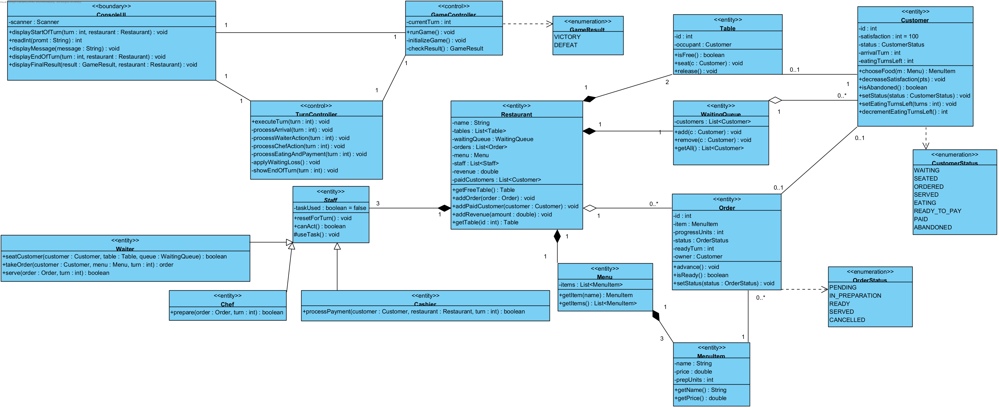

# Stage 1: Basic Restaurant Operation

## Overview

This directory contains the Stage 1 design deliverables, UML diagrams, and domain documentation for **Restaurant Rush** (a turn-based Java command-line restaurant management game).

Stage 1 establishes the baseline game architecture:
- **Game Duration:** 18 turns maximum.
- **Resources:** 2 tables, 1 Waiter (1 task/turn), 1 Chef (1 prep unit/turn), 1 Cashier (1 payment/turn).
- **Customers & Menu:** 6 Regular customer arrivals (turns 1, 4, 7, 10, 13, 16). 3 baseline menu items (Salad, Burger, Pasta).
- **Victory Condition:** At least 4 paid customers, revenue at least $45, and average satisfaction of paid customers at least 60.

---

## UML Diagrams

### 1. Class Diagram
The structural architecture adheres strictly to the **Boundary-Control-Entity (BCE)** pattern, isolating the console UI from business domain rules and control workflows.



### 2. Sequence Diagram
The dynamic interaction diagram captures the end-to-end turn execution lifecycle across Turns 1 to 6 (full customer arrival, ordering, cooking, serving, eating, billing, and table release) and Turn 18 (victory evaluation).


*Source Visual Paradigm project file containing both diagrams: [stage1_class diagram.vpp](stage1_class%20diagram.vpp)*

---

## Completed Classes

### Boundary
- `ConsoleUI` — Handles user input and terminal display only. Strictly decoupled from game rules and domain state.

### Control
- `GameController` — Oversees the complete 18-turn game loop, coordinates turns, and evaluates victory/defeat at game end.
- `TurnController` — Executes the strict 6-phase per-turn workflow (Arrivals $\to$ Manager choices $\to$ Kitchen/Serving $\to$ Eating/Payment $\to$ Satisfaction decay/Abandonment).

### Entities
- `Restaurant` — Central domain aggregate holding tables, waiting queue, active orders, menu, staff list, and revenue.
- `Table` — Tracks table occupancy and the seated customer.
- `WaitingQueue` — Manages the queue of arriving customers awaiting seating.
- `Customer` — Holds satisfaction score (starts at 100), current status, and autonomous food selection logic.
- `Order` — Encapsulates the ordered menu item, preparation progress units, owning customer, and status.
- `Menu` / `MenuItem` — Defines available catalog items (Salad: $9, 1 unit. Burger: $15, 1 unit. Pasta: $18, 2 units).
- `Staff` — Abstract base class enforcing the shared one-task-per-turn constraint (`canAct()`, `useTask()`).
- `Waiter` / `Chef` / `Cashier` — Subclasses of `Staff` implementing role-specific actions (seating/ordering/serving, kitchen preparation, payment collection).

### Enumerations
- `CustomerStatus` — `WAITING`, `SEATED`, `ORDERED`, `SERVED`, `EATING`, `READY_TO_PAY`, `PAID`, `ABANDONED`
- `OrderStatus` — `PENDING`, `IN_PREPARATION`, `READY`, `SERVED`, `CANCELLED`
- `GameResult` — `VICTORY`, `DEFEAT`

---

## Sequence Diagram Flow Summary

| Turn / Frame | Actions & Object Interactions | Key State Transitions |
|---|---|---|
| **Turn 1** | Customer 1 arrives with satisfaction 100. Joins `waitingQueue`. Manager directs `waiter` to seat Customer 1 at Table 1. | Customer `WAITING` $\to$ `SEATED`. Satisfaction: 100 $\to$ 92 (-8). |
| **Turn 2** | `waiter` takes order for Pasta ($18, 2 units) $\to$ creates `Order 101`. Manager directs `chef` to cook Order 101 (1 unit). | Customer `ORDERED`. Order `IN_PREPARATION` (1/2 units). Satisfaction: 92 $\to$ 84. |
| **Turn 3** | `chef` cooks second unit of Order 101 (2/2 units) $\to$ completes preparation. | Order `READY`. Satisfaction: 84 $\to$ 76. *(Cannot be served this turn)* |
| **Turn 4** | `waiter` serves Order 101 to Table 1. Customer begins eating (1 turn duration). | Order `SERVED`. Customer `EATING`. Satisfaction decay stops (remains 76). |
| **Turn 5** | Eating turn elapses (`decrementEatingTurnsLeft()`). | Customer `EATING` $\to$ `READY_TO_PAY`. |
| **Turn 6** | `cashier` automatically collects bill ($18.00), records satisfaction (76), and releases Table 1. | Customer & Order `PAID`. Table freed. Revenue $+=\$18.00$. |
| **Turn 18** | `GameController.checkResult()` validates win conditions ($\ge 4$ paid, $\ge \$45$, $\ge 60$ avg sat). | `VICTORY` displayed via `ConsoleUI`. |

---

## Completed Relationships

| Relationship | Type | Multiplicity | Description |
|---|---|---|---|
| `Waiter`, `Chef`, `Cashier` $\to$ `Staff` | Generalization | — | Staff inheritance implementing role-specific actions |
| `ConsoleUI` — `GameController` | Association | 1 — 1 | UI boundary to game lifecycle coordinator |
| `ConsoleUI` — `TurnController` | Association | 1 — 1 | UI boundary to turn coordinator |
| `GameController` — `TurnController` | Association | 1 — 1 | Game lifecycle coordinator delegates turn steps |
| `TurnController` — `Restaurant` | Association | 1 — 1 | Turn coordinator updates domain aggregate |
| `Restaurant` — `Table` | Composition | 1 — 2 | Restaurant owns physical dining tables |
| `Restaurant` — `WaitingQueue` | Composition | 1 — 1 | Restaurant owns customer waiting area |
| `Restaurant` — `Staff` | Composition | 1 — 3 | Restaurant manages staff roster |
| `Restaurant` — `Menu` | Composition | 1 — 1 | Restaurant owns food catalog |
| `Menu` — `MenuItem` | Composition | 1 — 3 | Menu contains individual food items |
| `Restaurant` — `Order` | Aggregation | 1 — 0..* | Restaurant references active/historical orders |
| `WaitingQueue` — `Customer` | Aggregation | 1 — 0..* | Queue holds arriving customers |
| `Table` — `Customer` | Association | 0..1 — 1 | Table references currently seated customer |
| `Customer` — `Order` | Association | 0..1 — 0..1 | Customer is linked to their placed food order |
| `Order` — `MenuItem` | Association | 0..* — 1 | Order specifies chosen menu item |
| `Customer` $\to$ `CustomerStatus` | Dependency | — | Customer uses status enum |
| `Order` $\to$ `OrderStatus` | Dependency | — | Order uses preparation status enum |

---

## Reproducible Test Runs

Stage 1 includes scripted test inputs to verify both game outcomes:

### 1. Victory Run
- Demonstrates achieving all targets (5 Paid customers, $66.00 revenue, 79.2 average satisfaction).
- Run with:
  ```bash
  java -cp bin Main --replay < docs/stage1/stage1-victory-input.txt
  ```

### 2. Defeat Run
- Demonstrates outcome when manager takes no action.
- Run with:
  ```bash
  java -cp bin Main --replay < docs/stage1/stage1-defeat-input.txt
  ```

